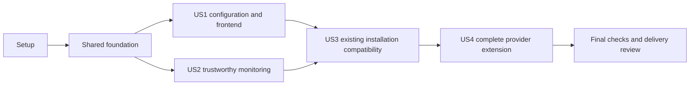

# Tasks: External Hazard Provider Plugins

**Input**: Design documents in `docs/features/001-external-provider-plugins/`.

**Prerequisites**: [plan.md](plan.md), [spec.md](spec.md), [research.md](research.md),
[data-model.md](data-model.md), [provider contract](contracts/provider-interface.md),
[configuration contract](contracts/configuration-api.md), and
[validation guide](quickstart.md).

**Tests**: Required by FR-018, SWR-EXT-027, and the constitution. Add the listed
regressions before the corresponding implementation, demonstrate the intended
failure, then make them pass. Existing passing tests do not prove the extension.

**Organization**: Shared foundation followed by the four user stories in spec
priority order. All tasks start unchecked; this file authorizes no deployment.

## Format: `[ID] [P?] [Story] Description`

- `[P]` identifies different-file work that may proceed alongside other ready
  tasks in its dependency wave, after its named prerequisites pass.
- `[US1]` through `[US4]` map directly to the specification's user stories.
- Setup, foundation, and final verification tasks have no story label.
- Task order is the safe default. Parallel markers never bypass prerequisites
  or permit concurrent edits to the same file.

## Path Conventions

All task paths are repository-relative. Paths marked **new** are implementation
outputs, not files created by this task-generation command. Reuse the current
backend/frontend layout and current task branch. Preserve HARA, source model 2,
existing runtime identities, and unrelated working changes.

## Phase 1: Setup (Shared Infrastructure)

**Purpose**: Establish the existing environment and controlled test support;
do not initialize another application or add a new framework.

- [X] T001 Confirm the implementation scope, current branch, Python 3.10+/Node 20 environment, and existing check baseline against `AGENTS.md`, `CONTRIBUTING.md`, and `docs/features/001-external-provider-plugins/plan.md`; record deviations in `docs/features/001-external-provider-plugins/tasks.md` without changing unrelated files.
- [ ] T002 Create **new** `backend/tests/provider_plugin_support.py` containing isolated synthetic non-PL warning adapters with `region_code`, a provider-owned packaged `feed_variant` field, wind-only coverage, and a second same-capability identity; provide fake clocks/results and registry restoration without production registration or network/actuator calls.

## Phase 2: Foundational (Blocking Prerequisites)

**Purpose**: Supply one typed provider contract and validation path used by all
stories. Complete T003..T013 before starting a story's implementation.

### Foundation regression tests

- [ ] T003 [P] Add **new** `backend/tests/test_external_provider_registry.py` covering duplicate/unknown IDs, collisions in either derived contributor or MQTT identity, capability-hazard mismatch, undeclared required fields, closed schemas, provider-owned packaged fields, and deterministic schema export that refreshes after isolated registration changes.
- [ ] T004 [P] Add **new** `backend/tests/test_external_provider_configuration.py` covering inherited versus explicit enablement, parameter-only bindings, disabled incomplete values, unknown supplied keys, C-EXT disabled without an active site, legacy-only resolution before requiredness, and equivalent compiler/startup errors with no validation-time I/O.

### Shared models and provider declarations

- [ ] T005 Extend typed definitions/bindings and adapter registration in `backend/components/external_apis/core/models.py`, `backend/components/external_apis/core/api_component.py`, and `backend/components/external_apis/core/registry.py`: enforce "Non-empty stable registry key", "Exactly one of the three existing capabilities", "Non-empty set of existing HazardType", "Set of uppercase two-letter country codes", "Empty means global; missing/unknown metadata never means global", "Set of declared parameter names", and "Plain localized text resolved from packaged keys"; retain closed provider-owned runtime/parameter models.
- [ ] T006 [P] After T005, declare weather-model coverage, empty editable parameters, and friendly metadata in `backend/components/external_apis/open_meteo_weather/component.py` and `backend/components/external_apis/open_meteo_weather/schema.py`; retain the four existing weather hazards, units, packaged transport bounds, and default-source role.
- [ ] T007 [P] After T005, declare AQ coverage, empty editable parameters, and friendly metadata in `backend/components/external_apis/open_meteo_air_quality/component.py` and `backend/components/external_apis/open_meteo_air_quality/schema.py`; preserve explicit European AQI/units and reject reinterpretation as another index.
- [ ] T008 [P] After T005, implement IMGW-owned parameter/compatibility validation in `backend/components/external_apis/imgw_warnings/schema.py` and `backend/components/external_apis/imgw_warnings/component.py`: "Codes are strings; trim whitespace, require four ASCII digits, preserve leading zeros, and reject duplicates after normalization"; resolve the legacy site alias, compare simultaneous normalized sets independently of order, and never treat a supplied conflicting empty list as absent.
- [ ] T009 Add **new** `backend/components/external_apis/core/configuration.py` with a pure typed resolver: capture explicit field presence before merging, validate supplied shape, resolve provider-owned aliases/conflicts, then enforce active requiredness; return normalized parameters, transport, applicability, and provenance without mutating source or performing I/O.
- [ ] T010 Dispatch packaged provider entries through each registered provider's closed runtime model in `backend/system_configuration.py`; retain shared transport bounds and `ProviderRuntimeSource` as a reusable base, and accept the synthetic `feed_variant` only through its owner's schema without modifying a universal field list.
- [ ] T011 Integrate the resolver into `backend/configuration_model.py` and `backend/build_app_config.py` so compilation rejects invalid active providers before save/import can succeed; preserve optional explicit boolean `enabled`, omitted-field serialization, shared HA coordinates/country/timezone, and additive generated parameters/selection provenance under source model 2.
- [ ] T012 Reuse the same resolver rules in `backend/components/app_config_validator/app_cfg_validator.py` and `backend/SafetyFunctions.py`; build one validated installed-provider catalogue, separate internal parameter/provenance fields before transport-model validation, and construct adapters without polling or changing startup order.
- [ ] T013 Add the **new** typed provider core resolver and appropriate newly typed shared boundaries to `mypy.ini`, finish public docstrings/type annotations in `backend/components/external_apis/core/`, and make T003/T004 plus existing compiler/provider regressions pass without reducing lint/type-check scope.

**Checkpoint**: Shared resolution rejects invalid provider input before persistence
and startup. Existing bundled sources still work; story-specific UI, diagnostics,
and complete synthetic-provider acceptance remain separate tasks.

## Phase 3: User Story 1 - Configure a Provider for the Installation (Priority: P1)

**Goal**: Operators can select applicable bundled providers and edit their own
regional parameters through the existing authenticated configuration flow.

**Independent Test**: With Polish and controlled non-Polish metadata, save valid
parameters, reject invalid explicit choices before replacement, preserve drafts,
and verify no TERYT requirement for the unrelated regional source.

### Tests for User Story 1

- [ ] T014 [P] [US1] Extend `backend/tests/test_user_config_api.py` with registry-derived catalogue/schema agreement, invalid-provider save/import rejection before byte replacement, invalid saved-source readability, existing route/envelope/revision behavior, and bounded structured 422 errors including one-over-limit cases.
- [ ] T015 [P] [US1] Add **new** `frontend/src/domain/providerConfiguration.test.ts` for typed metadata decoding, all catalogue budgets, supported schema constraints, inherited/explicit choices, unknown/incompatible IDs, unchanged drafts on read, and inline error-path mapping without parsing exception strings.
- [ ] T016 [P] [US1] Add **new** `frontend/src/components/ProviderParameterEditor.test.tsx` for declared scalar/enum/string-array fields, nullable/required/default/length/range/pattern rules, labels, unsupported metadata, and retained disabled values; register this component test in `frontend/tsconfig.test.json` so `npm test` compiles and runs it.

### Implementation for User Story 1

- [ ] T017 [US1] Build one schema/catalogue exporter in `backend/components/external_apis/core/registry.py` and `backend/components/external_apis/core/configuration.py` for closed per-provider parameters and namespaced local definitions; enforce "1 MiB" catalogue, "64" providers, "64 KiB" schema, "64" properties, "128" local definitions, depth "8", reference hops "16", "1024" enum choices, title/enum-label "256 characters", help "2048 characters", and pattern "256 characters" budgets from the configuration contract without changing legacy source limits.
- [ ] T018 [US1] Extend `backend/user_config_api.py` additively with `provider_metadata_version: 1`, retained `provider_plugins`/`countries`/`enabled`, provider schemas/defaults/capability/hazards, and optional structured `field_errors`; enforce "32 errors", "16 segments", "128 characters" per string segment, and "512 characters" per field message, retaining existing 422/409/general messages, readable invalid source, atomic saves, and separate restart behavior.
- [ ] T019 [US1] Add **new** `frontend/src/domain/providerConfiguration.ts` with typed catalogue/source/error records, the exact T017/T018 decoding budgets, supported closed flat field vocabulary, controlled local-reference normalization, and immutable applicability/draft helpers; reject unknown versions/cycles/external refs and retain omitted enablement rather than materializing defaults.
- [ ] T020 [US1] Add typed configuration errors and metadata handling to `frontend/src/userConfigurationApi.ts`, preserving all current requests/responses and old-server `error/message` fallback while exposing structured field errors and retaining the current draft/revision after failed requests.
- [ ] T021 [US1] Implement **new** `frontend/src/components/ProviderParameterEditor.tsx` using existing field primitives and T019 metadata; support string/boolean/finite number/integer/string enum/bounded string arrays and declared constraints, with plain-text help, keyboard labels, and explicit errors for unsupported metadata instead of a generic arbitrary-dictionary editor.
- [ ] T022 [US1] Integrate provider selection and parameter fields in `frontend/src/pages/Configuration.tsx` using the typed domain/editor: expose inherited/enabled/disabled intent, show incompatible or unknown explicit entries for correction, preserve values across country/subpage changes, and project legacy-only TERYT without dirtying or rewriting the draft.
- [ ] T023 [US1] Update development-only catalogue/configuration mocks in `frontend/src/userConfigurationApi.ts` with complete metadata, canonical and legacy Polish inputs, and a controlled non-Polish parameter fixture; keep mock data unavailable to the production provider registry and preserve imported/saved draft semantics.
- [ ] T024 [US1] Add **new** `frontend/tests/ui/provider-configuration.spec.ts` exercising valid Polish/non-Polish setup, missing/unknown parameters, incompatible explicit selection, disabled-value retention, field errors, metadata rejection, keyboard navigation, and narrow layout against mock mode only; make T014..T016 and these scenarios pass.

**Checkpoint**: US1 is a demonstrable local configuration increment. Its save
path validates providers; it is not sufficient evidence to deploy the complete
safety extension before the remaining stories and final gates pass.

## Phase 4: User Story 2 - Retain Trustworthy Monitoring During Source Failures (Priority: P1)

**Goal**: Diagnostics, coverage, hazard evaluation, and presentation distinguish
valid empty evidence from missing/failed/unsupported data without unsafe clears.

**Independent Test**: Feed controlled results with mixed hazard coverage and two
same-capability providers. Verify retained active evidence, exact failed-source
restrictions, healthy-peer usability, and explicit no-source coverage.

### Tests for User Story 2

- [ ] T025 [P] [US2] Extend `backend/tests/test_external_apis.py` with wrong provider/hazard, duplicate snapshot IDs, missing/invalid times, wrong/non-finite measurement values/units, partial model results, and complete healthy empty official feeds; assert rejected replacements preserve accepted evidence and original timestamps through existing `schema_error` semantics.
- [ ] T026 [P] [US2] Extend `backend/tests/test_external_hazard_component.py` and `backend/tests/test_external_hazard_policy.py` for wind-only coverage, active-source conflicts, no-source/awaiting evidence, stale/failure after assertion, authoritative expiry without a usable refresh, all-relevant-source clearing, and independent physical-closure/hysteresis/qualification behavior.
- [ ] T027 [P] [US2] Extend `backend/tests/test_self_diagnostics.py` and `backend/tests/test_degradation.py` with arbitrary registered providers, two sources sharing a capability, source/hazard-specific targets, unknown evidence-source conservatism, and independent failure/recovery/re-evaluation without peer release or command replay.
- [ ] T028 [P] [US2] Extend `frontend/src/domain/safety.test.ts` for additive supported hazards/coverage details, unavailable versus unconfigured versus healthy-empty official sources, mixed source failure, stale retained diagnostics, and stable fallback behavior for older aggregate attributes.

### Implementation for User Story 2

- [ ] T029 [US2] Validate normalized complete results against installed provider definitions in `backend/components/external_apis/core/api_component.py` and `backend/components/external_apis/core/models.py` before a successful `external_api_result` is dispatched; preserve immutable existing contracts and the raw states "ok", "stale", "unavailable", and "schema_error", with no fabricated source freshness.
- [ ] T030 [US2] Replace fixed provider-name health allocation in `backend/components/core/self_diagnostics.py` and wire the installed catalogue in `backend/SafetyFunctions.py`; retain `ExternalDataUnavailable` and `ProviderHealth{ProviderId}`, independent capability contributors, and diagnostics-before-polling ordering while excluding inactive providers.
- [ ] T031 [US2] Replace capability-to-single-provider maps in `backend/components/core/degradation.py` with catalogue-derived exact consumer hazard/opening targets and optional provider scope; include scope in pending re-evaluation, retain generic non-provider bindings, and ensure provider A cannot block valid provider B solely through A's own failure.
- [ ] T032 [US2] Update `backend/components/safetycomponents/external_hazard/external_hazard_component.py` to select active applicable providers by declared hazard as well as capability, retain any valid active source, and permit data-based clear only for a "non-empty relevant set" with "fresh complete healthy results from all members" and existing delay/hysteresis; preserve positive opening closure as an independent path.
- [ ] T033 [US2] Add diagnostic `hazards` and aggregate `coverage_details` in `backend/components/safetycomponents/external_hazard/external_hazard_component.py` with capability/hazard/selected-provider context and derived reasons "not_configured", "unsupported", "awaiting_evidence", "unavailable", "available", and "no_current_warnings"; do not replace existing provider, hazard, or global coverage raw states/attributes.
- [ ] T034 [US2] Decode and present additive coverage in `frontend/src/domain/safety.ts` and `frontend/src/pages/ExternalHazards.tsx`, preserving capability-based official-source recognition, old-attribute fallback, friendly Polish labels, and explicit unsupported/unconfigured coverage without provider-name branches.
- [ ] T035 [US2] Add **new** `frontend/tests/ui/external-provider-coverage.spec.ts` for mock healthy empty, active warnings, unavailable source, missing official source, unsupported hazard, and same-capability peer failure; make T025..T028 and these cases pass without live HA or actuators.

**Checkpoint**: Raw health, capability coverage, and hazard activation remain
separate. Failure or recovery of one provider cannot manufacture a hazard clear
or remove another source's restriction.

## Phase 5: User Story 3 - Preserve an Existing Installation (Priority: P1)

**Goal**: Existing Polish/Berlin configurations, legacy TERYT, source model 2,
runtime consumers, and explicit operator edits remain compatible.

**Independent Test**: Round-trip canonical/legacy/equal/conflicting inputs, compare
existing generated identities, and exercise source-preserving browser edits and
revision failures without modifying an installation-owned file.

### Tests for User Story 3

- [ ] T036 [P] [US3] Extend `backend/tests/test_config_compiler.py` with canonical/legacy/reordered-equal/conflicting/empty/leading-zero/duplicate TERYT matrices, omitted enablement provenance, and Polish/Berlin model-2 compatibility; preserve a sanitized legacy input as **new** `backend/tests/fixtures/external_apis/legacy_user_config.yml` before updating public examples.
- [ ] T037 [P] [US3] Extend `backend/tests/test_user_config_api.py` with no-rewrite reads, legacy field provenance, saved unset-field retention, invalid alias save/import unchanged bytes/revision, stale revision rejection, readable invalid source, and the unchanged explicitly confirmed restart boundary.
- [ ] T038 [P] [US3] Extend `frontend/src/domain/providerConfiguration.test.ts` with legacy-only display/edit, new canonical input, equal-form atomic edits, conflicting-form deliberate reconciliation, disabled incomplete drafts, and country/subpage changes that preserve explicit intent and source paths.

### Implementation for User Story 3

- [ ] T039 [US3] Complete backwards-compatible generated-binding and constructor handling in `backend/components/app_config_validator/app_cfg_validator.py` and `backend/components/external_apis/core/api_component.py`: accept pre-extension bindings without provenance, preserve old caller construction, and apply strict explicit-selection rules to newly compiled sources without changing transport or identifier contracts.
- [ ] T040 [US3] Implement tested alias-edit/reconciliation helpers in `frontend/src/domain/providerConfiguration.ts` and `frontend/src/pages/Configuration.tsx`: legacy-only edits update that alias, new entries use canonical parameters, equal simultaneous forms update together, and conflicting forms require explicit reconciliation rather than silently choosing a value.
- [ ] T041 [US3] Update `backend/config/user_config.example.yml` and `docs/examples/example_house_user_config.yml` to explain canonical provider parameters and legacy acceptance while retaining a legacy regression fixture; keep `docs/examples/berlin_user_config.yml` free of TERYT and make all public examples compile with source model 2 and fake HA coordinates.
- [ ] T042 [US3] Extend `backend/tests/test_external_hazard_startup.py` with legacy/new configuration comparisons proving stable provider/fault/symptom/entity/topic/raw-state identities, inherited foreign default inactivity, unchanged timing/consent behavior, and no mandatory source rewrite or actuator calls.
- [ ] T043 [US3] Extend `frontend/tests/ui/provider-configuration.spec.ts` for no dirty state on legacy read, equal-form edits, visible conflicting values/reconciliation, retained drafts, and stale-revision correction; make T036..T038 and compatibility/startup/browser regressions pass.

**Checkpoint**: Existing integrations require zero mandatory configuration
rewrites and retain stable identities. Canonical fields are additive, and UI
editing cannot leave a stale contradictory alias behind.

## Phase 6: User Story 4 - Introduce Another Supported Warning Provider (Priority: P2)

**Goal**: Prove the whole extension boundary with controlled providers, not only
registration or isolated C-EXT acceptance. No real new national service is added.

**Independent Test**: Register synthetic non-PL sources only in test scope, use a
custom regional parameter and packaged field, and exercise compilation through
full startup, health/coverage, failure/recovery, presentation, and shutdown.

### Tests and acceptance for User Story 4

- [ ] T044 [P] [US4] Extend `backend/tests/test_external_hazard_startup.py` using `backend/tests/provider_plugin_support.py` to pass synthetic canonical `region_code` input through real temporary-file `UserConfigStore.import_yaml()` and `save()`, prove invalid variants retain saved bytes/revision, then compile the saved source and exercise complete SafetyFunctions startup, normalized dispatch, diagnostics, degradation, independent failure/recovery, and shutdown with no binding errors, provider-name policy additions, or household actuator calls.
- [ ] T045 [P] [US4] Extend `backend/tests/test_external_api_runtime.py` for the controlled providers with independent schedules, one in-flight request per provider, stalled-peer isolation, bounded queue behavior, timer cancellation, and late-result suppression after shutdown using fake clocks and bounded waits.
- [ ] T046 [P] [US4] Extend `frontend/tests/ui/provider-configuration.spec.ts` with the synthetic non-PL `region_code` provider, backend-shaped metadata, and its default model peers; prove parameter entry, save/reload intent, official coverage presentation, and missing-field errors without a frontend provider-name branch.
- [ ] T047 [US4] Add **new** `backend/tests/fixtures/external_apis/provider_contract.json` (sanitized shared fixture) and **new** `backend/tests/test_external_provider_conformance.py` covering all bundled definitions plus synthetic metadata/results, custom packaged fields, source-schema/catalogue agreement, field/error budgets at-limit and one-over, and synthetic absence from production registration.
- [ ] T048 [US4] Consume the shared sanitized contract fixture in `frontend/src/domain/providerConfiguration.test.ts` and extend `frontend/src/domain/safety.test.ts` to verify equivalent frontend decoding limits, provider semantics, and exact coverage projection; keep fixtures deterministic and free of private location, credentials, or live endpoint dependencies.
- [ ] T049 [US4] Execute the synthetic full-path acceptance in T044..T048 and record scenario-level evidence against SC-001..SC-007 in `docs/features/001-external-provider-plugins/tasks.md`; distinguish conforming test-source acceptance from support for a real national service and from authorization to deploy.

**Checkpoint**: A new conforming provider reaches all production integration
boundaries through its declarations and bundled registration. Existing safety
policy, shared diagnostics, and frontend logic do not need its name hardcoded.

## Phase 7: Polish & Cross-Cutting Concerns

**Purpose**: Complete operator documentation, locale parity, static checks,
release evidence, and the final safety review after all four stories pass.

- [ ] T050 [P] Update Polish operator guidance and examples in `frontend/CONFIGURATION.md` and `frontend/src/content/configurationHelp.ts` for provider choice, parameter requirements, inherited intent, coverage meanings, legacy TERYT edits, and separate save/restart behavior; avoid implementation details in the user flow.
- [ ] T051 [P] Complete friendly provider/parameter/coverage runtime labels in `backend/components/core/locales/en.yml`, `backend/components/core/locales/pl.yml`, and `backend/components/core/locales/de.yml`; extend `backend/tests/test_localization.py` to enforce equivalent meaning/key parity while preserving technical IDs and raw state codes.
- [ ] T052 Review final typed boundaries and purpose-oriented docstrings in `backend/components/external_apis/core/`, `backend/components/core/self_diagnostics.py`, `backend/components/core/degradation.py`, and `mypy.ini`; include all new typed modules, resolve change-related errors, and retain readable safety logic without unrelated refactors or weakened checks.
- [ ] T053 Run the complete backend Ruff, mypy, pytest, and coverage gates from `AGENTS.md` using the scenarios in `docs/features/001-external-provider-plugins/quickstart.md`; record exact commands/results, configured type scope, and coverage in `docs/features/001-external-provider-plugins/tasks.md`.
- [ ] T054 Run the full frontend tests, typecheck, zero-warning lint, formatting, build, and mock-only Playwright gates defined in `frontend/package.json` under Node 20; record results in `docs/features/001-external-provider-plugins/tasks.md`, prove changed files are formatted, and report existing repository-wide formatting failures separately without unrelated cleanup.
- [ ] T055 Reconcile implemented contracts, public examples, exported schemas, and requirement/test traceability across `docs/features/001-external-provider-plugins/`, `docs/features/External Hazard Monitoring - Architecture.md`, `docs/features/Configuration Model - Architecture.md`, `docs/sys/SafetyConcept - SYS.md`, and `docs/sys/SafetyComponent - SSRD.md`; validate links/tables/paths/commands and confirm `docs/sys/SafetyConcept - HARA.md` is unchanged.
- [ ] T056 Record the final branch/commit when created, completed story criteria, stable-identity/configuration compatibility, locale parity, remaining gaps, and all validation in `docs/features/001-external-provider-plugins/tasks.md`; preserve unrelated changes and require separate explicit authorization for deployment, live HA/actuator tests, or a push outside an authorized publish workflow.

## Dependencies & Execution Order

### Phase Dependencies

| Phase | Prerequisite | Completion gate |
| --- | --- | --- |
| Setup: T001..T002 | Existing approved design | Controlled test support and environment identified. |
| Foundation: T003..T013 | Setup | Shared schemas/resolver and equivalent compiler/startup validation pass. |
| US1: T014..T024 | Foundation | Applicable parameter editing and pre-save validation pass. |
| US2: T025..T035 | Foundation | Independent evidence/diagnostics/coverage and no unsafe clearing pass. |
| US3: T036..T043 | US1 and US2 integration seams | Existing configuration/identity and source-preserving UI edit regressions pass. |
| US4: T044..T049 | US1, US2, and US3 | Synthetic complete-path acceptance passes. |
| Final: T050..T056 | All four stories | Fresh local evidence, docs/locale parity, and scope review complete. |

### User Story Dependencies

US1 and US2 have independent fixture-based acceptance after the foundation and
can be developed in separate files. US3 builds on their final serialization,
runtime, and editor seams; it is tested through its own compatibility matrix.
US4 integrates the completed contracts and proves the extension end to end.

### Within Each User Story

Write and run its regressions before the matching implementation. Complete
models/validation before API or UI wiring, and core behavior before complete-path
acceptance. Finish each checkpoint before claiming that story is complete.

### Parallel Opportunities

- T003/T004 are separate foundation test modules after T002.
- T006/T007/T008 modify separate provider directories after T005.
- US1 test tasks T014/T015/T016 and US2 test tasks T025/T026/T027/T028 are
  separate-file waves after foundation completion.
- US1 and US2 implementation may overlap only where their files differ; sequence
  same-file changes within each story. US3 edits wait for both integration seams.
- T036/T037/T038 and T044/T045/T046 are separate-file acceptance waves after
  their phase prerequisites. T047 supplies the fixture required by T048.
- T050/T051 are separate documentation/localization outputs after all stories.

## Parallel Example: User Story 1

After foundation, write T014 API tests, T015 domain tests, and T016 component
tests concurrently. Backend T017/T018 and frontend T019 can proceed against the
agreed metadata contract in different files. After T019's types are ready, T020
API-client and T021 renderer work can proceed in parallel. Integrate the page
only after those seams exist.

## Parallel Example: User Story 2

After foundation, T025 adapter tests, T026 policy tests, T027 diagnostic tests,
and T028 frontend projection tests are independent. Backend T030/T031 source
allocation and frontend T034 presentation can overlap after their contracts and
fixtures are ready; edits to C-EXT in T032/T033 remain sequential.

## Parallel Example: User Story 3

After US1/US2, run T036 compiler regression authoring, T037 API regression
authoring, and T038 immutable draft-helper regression authoring in parallel.
Keep T040 helper/page edits sequential and run T042 identity and T043 browser
acceptance after the relevant implementation is complete.

## Parallel Example: User Story 4

After US1..US3, T044 startup acceptance, T045 runtime isolation, and T046 mock
configuration acceptance touch separate files. Share T002 support without
concurrent edits to it. Finish the shared contract fixture T047 before T048's
cross-language checks, then collect the complete evidence in T049.

## Implementation Strategy

### MVP First

Setup, foundation, and US1 provide the smallest useful local demonstration:
provider-specific configuration with backend validation and frontend editing.
This is a configuration demonstration, not a safety release. Production
readiness requires US2/US3 safeguards, US4 complete-path evidence, and final gates.

### Incremental Delivery

Implement and verify US1 and US2, integrate compatibility through US3, then prove
the extension with US4. Keep Open-Meteo default behavior and existing consumers
working throughout. No phase automatically deploys, restarts HA, operates devices,
installs arbitrary provider packages, or adds a real new national integration.

### Requirement Coverage

| Requirements | Main task allocation |
| --- | --- |
| FR-001..005 | T003..T024: definitions, resolution, metadata, editing, errors. |
| FR-006..008 | T005..T012, T025/T029: common adapters, semantics, and responsibility boundary. |
| FR-009..014 | T025..T035, T044/T045: diagnostics, coverage, clearing, and runtime isolation. |
| FR-015 | T008..T012, T036..T043: aliases, source format, stable identities. |
| FR-016..017 | T014/T018..T024, T037..T043, T050/T051: authenticated revisioned flow, consent, and language parity. |
| FR-018..019 | T042..T049, T052..T056: end-to-end evidence, existing safety boundaries, and final review. |

## Notes

Implementation status, baseline failures, and validation evidence belong in this
task record or review reports, not normative safety requirements. Add completion
evidence when tasks are executed; no task is completed merely by generating this
file. Use the existing 109-file formatting baseline only as context, never as a
reason to ignore new defects or skip fresh verification.

## Implementation evidence

- 2026-11-13, T001: current branch `open_spec_intruduction`; Python 3.10.5.
  The default Node runtime is 18.20.8, so frontend verification uses isolated
  Node 20. Checklist gate is 16/16. Existing Git/Docker/frontend ignore rules
  cover generated output and private installation configuration. The preceding
  baseline is recorded in the plan; all changed behavior requires fresh tests.
- Analysis refinements: clarify inherited default wording and reject collisions
  in either derived diagnostic identity while preserving existing provider IDs.
