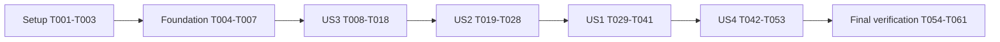

# Tasks: Complete Read-Only Heating Monitoring

**Branch**: `codex/003-heating-monitoring`

**Input**: [spec.md](spec.md), [plan.md](plan.md), [research.md](research.md),
[data-model.md](data-model.md), [contracts](contracts/) and [quickstart.md](quickstart.md).

**Tests**: Required by the safety acceptance criteria and plan. Write and observe
failing regressions before the corresponding production change. Existing passing
tests do not establish coverage of the newly identified negative cases.

**Organization**: One phase per story. All three P1 stories are preserved; their
tie is resolved safety-first: US3 retention, US2 detection, US1 admission, then
US4/P2 operator details. This follows the plan's requirement to fix lifecycle
defects before admitting broader profiles. IDs follow that execution order.

**Notation**: `[P]` means independent files and satisfied prerequisites at that
phase's entry. Tasks without it are sequential. New files are explicit targets,
not claims of existing implementation. No task authorizes household actions,
deployment, private configuration application or heating control.

## Phase 1: Setup

**Goal**: Preserve the workspace and reconcile safety intent before code changes.

- [ ] T001 Inspect `AGENTS.md`, `CONTRIBUTING.md`, `.specify/memory/constitution.md` and `docs/features/003-heating-monitoring/plan.md`; verify branch, checklist and current changes, preserve the earlier feature-002 audit, and record the starting scope in `docs/features/003-heating-monitoring/tasks.md`.
- [ ] T002 Reconcile retained heating assertions, deadline semantics, qualification metadata and diagnostic projection in `docs/sys/SafetyConcept - SYS.md`, `docs/sys/SafetyComponent - SSRD.md`, `docs/features/Heating System Monitoring - Architecture.md` and `docs/HEATING_MONITOR_DELIVERY.md` against the feature contracts before implementation; retain requirement IDs and HARA goals without weakening their budgets.
- [ ] T003 Inspect current heating source/configuration/tests and read any applicable ignored installation configuration without exposing private values; establish the actual baseline and trace FR-001..018, SC-001..009 and twelve story acceptance scenarios in `docs/features/003-heating-monitoring/tasks.md`, separating local verification from operational admission.

## Phase 2: Foundation

**Goal**: Provide deterministic fixtures, contracts and typed boundaries shared by
all stories. Complete this phase before production story work.

- [ ] T004 [P] Create `backend/tests/heating_support.py` with fictional product-neutral source, room, equipment-policy and current/retained episode fixtures; include coherent timestamps, independent need/request groups, allowed notification transport and a heating-actuator spy without copying installation bindings. Add two materially different equipment/source profiles with different units, raw status codes, firmware/profile references and deliberately missing capabilities; equivalent facts must produce equal normalized decisions without brand-specific rule branches.
- [ ] T005 Extend `backend/tests/heating_support.py` with deterministic wall/monotonic clocks, faulting/blocked temporary SQLite stores, controlled writer acknowledgements and ordered EventBus/MQTT capture so tests can prove the state before initial publication and distinguish observed time from downtime.
- [ ] T006 [P] Create `backend/tests/fixtures/heating/qualification_contract.json` as the sanitized shared backend/frontend contract matrix for diagnostic-only, qualified, partial, invalid, pending and retained states; identify schema versions, nullable unknown evidence and truncation cases from the feature contracts.
- [ ] T007 Review imports, purpose docstrings and typed public boundaries in `backend/components/safetycomponents/heating/` and `mypy.ini`; retain the existing 13-module scope and flags, and establish per-story inclusion of new typed modules/changed typed heating boundaries as they are introduced rather than listing nonexistent modules prematurely.

**Checkpoint**: Fixture/contract infrastructure is usable without household access;
source meanings and bounds are fixed by the design, not invented by test defaults.

## Phase 3: US3 - Preserve danger during reconfiguration and failure (P1)

**Goal**: Keep original heating H/incident evidence effective independently of
current component selection, storage availability and review diagnostics.

**Independent Test**: Assert R02, remove its rule/system or disable C-HVAC, restart
with the same store, and inspect the first fault/global publication. Inject failed
SET/CLEAR and reordered acknowledgements. No false healthy state or action replay.

### Tests first

- [ ] T008 [P] [US3] Add `backend/tests/test_heating_assertions.py` for closed ledger/record schemas, trusted rule-to-fault identity, incident UUID, finite values, key/record coherence, "current/retained/unverified" status, "<=4096 records" and "<=1 MiB serialized UTF-8" at-limit/one-over cases, atomic replacement and no active-record eviction.
- [ ] T009 [P] [US3] Add `backend/tests/test_heating_startup.py` for active/pending/recovery restart across R02 removal, profile incompatibility, room/system removal, rename and C-HVAC disable; prove original H active UNEVALUABLE before initial publication, conservative missing/corrupt-state reconciliation and no old timer, notification command, consent or proposal replay.
- [ ] T010 [P] [US3] Add `backend/tests/test_heating_persistence_lifecycle.py` for blocked/failing writes, one writer, "one in-flight and one coalesced pending ledger generation", bounded SET disposition, stale CLEAR acknowledgement after a newer SET, generation/cause conflicts and failure isolation from other safety paths.

### Implementation

- [ ] T011 [US3] Implement typed records and ledger codec in `backend/components/safetycomponents/heating/assertion_store.py` using SQLite namespace `heating_assertions`, "schema version 1", "<=4096 records" and "<=1 MiB serialized UTF-8"; retain stable symptom/fault/system/room identity, incident/onset, debt, cause/recovery references and fingerprints, resolve severity through trusted `heating/engine.py` RULES without promoting L4 information, and reject raw configuration/sample-buffer payloads.
- [ ] T012 [US3] Implement the bounded storage coordinator in `backend/components/safetycomponents/heating/assertion_store.py` with one in-flight and one coalesced pending generation, atomic commits and callback-thread completion; preserve positive H in memory, bound normal SET commit waiting to the validated allowance, publish H plus persistence D on failure/expiry, and require matching generation/incident/cause plus revalidated recovery before acknowledged CLEAR.
- [ ] T013 [US3] Extend `backend/components/safetycomponents/heating/state.py` and ledger bootstrap integration to read runtime checkpoint versions "1/2" idempotently, preserving valid active records and cause/clear ordering; an older snapshot must neither overwrite newer ledger state nor resurrect a cleared generation, and downtime/sample history must not supply new recovery observations.
- [ ] T014 [US3] Wire `backend/SafetyFunctions.py` and `backend/components/faults_manager/fault_manager.py` to open/reconcile the owner ledger and trusted retained heating fault definitions before initial fault/system publication, even when no heating component or current system is instantiated; include the authoritative current boot generation on owner/global projections, and retain bounded unknown active danger separately from persistence D when corrupt/missing state has active journal evidence.
- [ ] T015 [US3] Connect `backend/components/safetycomponents/heating/heating_system_monitor_component.py` to the same coordinator before enabling mechanisms; replace orphan-dropping restore and broad nonthermal storage suppression, preserve original H and incident identity through reconfiguration, and require full comparable source-observed recovery plus necessary durable acknowledgement without acknowledgement/downtime-based HEAL.
- [ ] T016 [US3] Carry retained heating danger and uncertainty through stable fault/global coverage in `backend/SafetyFunctions.py` and `backend/components/core/degradation.py`, including retained-only cases with no current system entity; do not substitute a review D for H or claim safe/full coverage from absent current contributors.
- [ ] T017 [US3] Update heating proposal restoration boundaries in `backend/components/recovery_manager/recovery_manager.py` and `backend/SafetyFunctions.py` so retained/configured heating symptoms cannot replay old proposals or consent; preserve unrelated manual recovery behavior and permit only newly qualified observations to create current recommendations.
- [ ] T018 [US3] Run the US3 assertion, persistence and startup suites plus existing heating/fault/recovery regressions; record red/green, first-publication, failed-CLEAR and zero-heating-actuation evidence in `docs/features/003-heating-monitoring/tasks.md` and expand `mypy.ini` for the new typed ledger/coordinator before completing this story.

**Checkpoint**: The reproduced lost-R02 case is closed; fresh positive nonthermal
hazard evidence remains effective during failed storage, and retained danger is
independent of the current configuration.

## Phase 4: US2 - Detect failure across the heating chain (P1)

**Goal**: Bound unresolved detection across target/phase changes while retaining
the implemented R01..R13 predicates and positive recovery semantics.

**Independent Test**: Feed coherent need/request/response/delivery samples, lower
still-unmet targets repeatedly and cross the original deadline. Verify specific H
or justified reconciliation loss, correct timing and no false recovery.

### Tests first

- [ ] T019 [P] [US2] Extend `backend/tests/test_heating_rules.py` with R03 room "18 C/target 21 C" lowered to "20 C" and R04 flow "25 C/target 45 C" lowered to "35 C", fresh samples each "5 s" and test unresolved budget "120 s"; test deadline-1/exact/+1, the reproduced "205 s" case, repeated changes, permission withdrawal, attained targets, restart and non-comparable evidence without invented mechanical failure.
- [ ] T020 [P] [US2] Add `backend/tests/test_heating_timing.py` for "<=60 s" source supervision, "<=1800 s" heating loss and the actual writer/ack stage, both reconciliation stages and notification reserve; cover a valid "10+5+10+1+30=56 s" allocation, boundary/one-over rejection, clock jumps and separately reviewed R10/R11 equipment timing. Include exact reviewed HSM-H05/<EquipmentProfileKey> admission and a plausible, physically dangerous temperature that must reach R10/R11; no plausibility range may mask it.
- [ ] T021 [P] [US2] Extend `backend/tests/test_heating_output.py` and `backend/tests/test_heating_additional_rules.py` with full-chain R01..R13 integration fixtures spanning DHW, overrun, startup, anti-cycle, load/topology, room trends, sample gaps, replay and counter resets; preserve rule-specific positive recovery and distinguish optional diagnostics from heating loss. Explicitly test versioned manufacturer/model code interpretation: normal operation, blocking fault, maintenance, historical last error and unknown code; unknown creates interpretation/coverage loss rather than fabricated healthy/faulty state.

### Implementation

- [ ] T022 [US2] Correct `_demand` and `_response` in `backend/components/safetycomponents/heating/rules.py` so target lowering preserves original onset/reference/debt and cannot return indefinitely before deadline evaluation; comparable unmet need must receive its qualified decision, while non-comparable context receives explicit bounded coverage/reconciliation loss rather than a fabricated H or automatic clear.
- [ ] T023 [US2] Integrate exhausted-deadline and quality-cause handling in `backend/components/safetycomponents/heating/heating_system_monitor_component.py`; prevent INHIBITED/pending state, phase changes or restored debt from renewing the unresolved budget, and connect the proper R01 diagnostic escalation without concealing an independently active H.
- [ ] T024 [US2] Enforce aggregate timing admission in `backend/components/safetycomponents/heating/schema.py`, `backend/system_configuration.py` and `backend/build_app_config.py`, counting age, acquisition, both evaluations, windows/allowances, failure confirmation, actual write acknowledgement, decision and notification reserve; preserve "<=60 s" and "<=1800 s", with equipment-specific R10/R11 allocations rather than generic room/heating budgets.
- [ ] T025 [US2] Reconcile shared episode/recovery context across `backend/components/safetycomponents/heating/output.py`, `backend/components/safetycomponents/heating/distribution.py`, `backend/components/safetycomponents/heating/thermal.py` and `backend/components/safetycomponents/heating/cycling.py` only where the new integration tests expose a dependency; reuse existing kernels and preserve source-window coverage, thermal-positive handling and comparable recovery.
- [ ] T026 [US2] Preserve multi-cause fault/incident and measured recovery context through `backend/components/safetycomponents/heating/heating_system_monitor_component.py` and existing notification/manual-recovery interfaces; keep original incident correlation, explicit targets, bounded accepted-by-HA attempt semantics and independent C-TEMP ownership without adding heating service calls.
- [ ] T027 [US2] Extend `backend/tests/test_heating_startup.py` with an actual stub-wired need -> request -> response -> delivery fault/recovery flow through FaultManager and notification/manual recovery, exercising multiple rooms/causes and the validated end-to-end deadlines rather than directly forcing fault state.
- [ ] T028 [US2] Run the US2 rule, timing, output, additional-rule and startup acceptance plus unchanged temperature/entity-supervision regressions; record measured deadline accounting, no-action assertions and any excluded equipment capability in `docs/features/003-heating-monitoring/tasks.md`.

**Checkpoint**: Still-unmet lowered targets cannot silently exceed their original
deadline. Qualified detection and recovery remain distinct from notification receipt.

## Phase 5: US1 - Understand and qualify heating coverage (P1)

**Goal**: Admit a rule only with reviewed source, equipment, timing and
independence evidence, and expose actionable readiness without fabricating facts.

**Independent Test**: Validate and edit diagnostic-only, incomplete and fully
qualified fictional installations; inspect rejected save/revision behavior and
the separation between draft, saved source guidance and applied monitoring.

### Tests first

- [ ] T029 [P] [US1] Add `backend/tests/test_heating_qualification.py` for optional per-system qualification with "schema_version: 1", required equipment/policy/review/binding evidence, "192 binding records", "512 characters" per text field, "128 KiB UTF-8" per object, "64-character lowercase SHA-256" policy fingerprints, aware UTC review time, positive finite cadence and rejected unknown/mismatched roles; include each limit and one-over case.
- [ ] T030 [P] [US1] Extend `backend/tests/test_config_compiler.py` and `backend/tests/test_user_config_api.py` for source model "2", existing Diagnostic compatibility, selected-policy fingerprinting, atomic invalid-save rejection, unchanged revision/bytes and additive `heating_qualification` metadata bounded to "64 KiB UTF-8", "16 systems" and "13 rule summaries/system" with marked truncation.
- [ ] T031 [P] [US1] Add `frontend/src/domain/heatingQualification.test.ts` consuming the shared JSON fixture for bounded metadata, unknown readiness, immutable draft retention, role/room errors and policy mismatch; reject any implied `qualified: true` shortcut and prevent saved-source metadata from establishing applied monitoring health.
- [ ] T032 [P] [US1] Add `frontend/tests/ui/heating-configuration.spec.ts` for Polish profile/source-role guidance, original-time selectors, required evidence, failed revisions, valid save/reopen, keyboard use and 390 px layout with all non-local requests blocked.

### Implementation

- [ ] T033 [US1] Extend `backend/components/safetycomponents/heating/schema.py` and `backend/configuration_model.py` with the exact optional qualification fields/bounds from `contracts/source-admission.md`, including role or `rooms.<room>.<role>` keys, producer/meaning/cadence/independence and optional topology evidence; retain default "8 systems", ceiling "16 systems", "32 rooms/system", "32 installation inputs", collision checks, finite values and explicit unknown evidence.
- [ ] T034 [US1] Integrate qualification validation/fingerprints in `backend/build_app_config.py`, `backend/system_configuration.py` and `backend/components/app_config_validator/app_cfg_validator.py`; exclude friendly labels/samples/secrets from policy hashes, compare normalized binding contracts separately, enforce required paths and ledger admission capacity, and keep absent qualification Diagnostic-only rather than reinterpret contact as physical evidence.
- [ ] T035 [US1] Add bounded read-only saved-source `heating_qualification` metadata to authenticated `GET /api/config` in `backend/user_config_api.py`, with selected policy fingerprint, required evidence and reasons per system/rule; preserve import/save error budgets, atomic revisions and restart boundaries, adding no control endpoint or secret-bearing context.
- [ ] T036 [US1] Extend `frontend/src/userConfigurationApi.ts` and create `frontend/src/domain/heatingQualification.ts` to decode the new bounded metadata and per-role readiness safely, retaining draft/saved/applied distinctions, unknown/truncation indicators and all existing configuration/provider contracts.
- [ ] T037 [US1] Update `frontend/src/pages/Configuration.tsx` and `frontend/src/components/configurationFieldSchemas.ts` to expose semantic inputs, original-time sources, qualification references and profile readiness with conditional validation; keep calibration system-owned and add no actuator, reset or arbitrary service field.
- [ ] T038 [US1] Connect admission outcomes to runtime evidence in `backend/components/safetycomponents/heating/inputs.py`, `backend/components/safetycomponents/heating/schema.py` and `backend/components/safetycomponents/heating/heating_system_monitor_component.py`; require actual freshness/independence/topology as well as reviewed references, explicitly excluding unsupported/shadow paths while retaining the R01 diagnostic function. Verify Group B registration for every admitted input and timestamp source, shared consumer quality/timing contracts and fault ownership; retain shared C-TEMP ownership and reject conflicting contracts without duplicate alarms.
- [ ] T039 [US1] Synchronize Polish field guidance in `frontend/src/content/configurationHelp.ts` and `frontend/CONFIGURATION.md`, public `backend/config/user_config.example.yml` and `docs/reference/System Configuration.md`; use fictional demonstrators, retain valid Diagnostic examples and never supply invented production manufacturer limits or timestamps.
- [ ] T040 [US1] Create a sanitized `docs/features/003-heating-monitoring/commissioning-readiness.md` inventory separating required path/rule, proven producer semantics/cadence, equipment calibration, independence and outstanding external producer work; record the current seven availability-only inputs and absent rooms/request without publishing bindings or claiming full admission.
- [ ] T041 [US1] Run US1 qualification/compiler/API/client/browser acceptance and compile the public examples; record valid/invalid boundary, source-equivalence, revision and zero-control outcomes in `docs/features/003-heating-monitoring/tasks.md`, leaving unproven installation facts as explicit exclusions/prerequisites.

**Checkpoint**: A selected broader profile cannot manufacture source meaning,
freshness, independent need or equipment calibration. Diagnostic-only files remain
readable and partial; full-chain readiness is testable with qualified fixtures.

## Phase 6: US4 - Read actionable heating evidence (P2)

**Goal**: Show independent health, phase, coverage and retained danger with
readable pending/recovery evidence using applied runtime truth.

**Independent Test**: Render complete, partial, pending, active, retained-only,
failed-storage, old-schema, stale and disconnected snapshots on desktop/mobile.

### Tests first

- [ ] T042 [P] [US4] Add `backend/tests/test_heating_diagnostics.py` for "schema_version: 2", per-start runtime generation, independent phase/health/coverage, retained-only fault/global projection, nullable unknowns and "13 rule summaries", "32 expanded contributor summaries per selected rule", "64 input summaries", "32 retained summaries" and "256 KiB UTF-8" payload limits with totals/truncation and one-over cases.
- [ ] T043 [P] [US4] Extend `frontend/src/domain/heating.test.ts` for strict v2/generation-aware bounded decoding, unknown values instead of zero, partial/excluded coverage, source ages, elapsed/remaining time, inhibition and active retained evidence; disconnect/old-schema/generation mismatch must invalidate current health without erasing danger.
- [ ] T044 [P] [US4] Add `frontend/tests/ui/heating.spec.ts` using mock-only desktop/mobile fixtures for the operator contract, including keyboard labels, 390 px layout, truncated evidence, retained danger without a current system entity, incident-filtered attempts and accepted-by-HA wording rather than confirmed phone receipt.

### Implementation

- [ ] T045 [US4] Replace constant partial/degraded projection in `backend/components/safetycomponents/heating/heating_system_monitor_component.py` with derived required-path coverage and independent health/phase/active fault state; publish diagnostic "schema_version: 2", shared runtime ID, all operator-evidence fields and the exact summary/payload bounds from T042, prioritizing visible active danger with explicit truncation totals.
- [ ] T046 [US4] Update `frontend/src/domain/heating.ts` and `frontend/src/hooks/useSafetyEntities.ts` to decode applied diagnostic version/generation against the authoritative owner/global boot projection, invalidate connection/generation mismatches and bound current/retained evidence; represent unknown age/value/budget explicitly, distinguish Diagnostic admission from full coverage and reject saved/draft metadata as monitoring truth.
- [ ] T047 [US4] Complete `frontend/src/pages/Heating.tsx` with readable source age, measured/current/original target, units, elapsed/remaining budget, inhibition and positive-recovery wait; retain separate phase, coverage, fault activation and optional exclusions with accessible desktop/mobile presentation.
- [ ] T048 [US4] Integrate retained heating evidence into `frontend/src/domain/safety.ts` and `frontend/src/components/FaultSection.tsx` so stable fault/global views preserve removed-system H/incident context independently of current system cards and disconnected metrics, without changing external-provider or other component semantics.
- [ ] T049 [US4] Connect heating incident details to existing filtered attempt history in `frontend/src/components/EntityDetailsDialog.tsx` and `frontend/src/pages/Heating.tsx`; retain notification-history-before-entity-history ordering, original incident identity and truthful accepted/rejected/pending submission outcomes without a new delivery journal or heating controls.
- [ ] T050 [US4] Add equivalent phase/readiness/retained/pending/recovery labels in `backend/components/core/locales/en.yml`, `backend/components/core/locales/pl.yml` and `backend/components/core/locales/de.yml`, extending `backend/tests/test_localization.py` for key/placeholder parity while keeping machine identifiers unchanged.
- [ ] T051 [US4] Update Polish heating help/operator documentation in `frontend/src/domain/monitoringHelp.ts`, `frontend/CONFIGURATION.md` and new `frontend/HEATING.md`; link the guide from `frontend/README.md` and explain actual coverage, retained warnings, source age, pending recovery and manual-only boundaries without development internals in operator flows.
- [ ] T052 [US4] Extend shared fixture conformance checks in `backend/tests/test_heating_diagnostics.py` and `frontend/src/domain/heating.test.ts` to verify identical field meanings, nullability, units, truncation and current/retained generation handling against `backend/tests/fixtures/heating/qualification_contract.json`.
- [ ] T053 [US4] Run US4 backend/domain/component/browser acceptance and unchanged dashboard/fault/history flows; record schema, timing-detail, accessibility, no-healthy-on-disconnect and no-network/no-heating-actuation evidence in `docs/features/003-heating-monitoring/tasks.md`.

**Checkpoint**: The operator can distinguish monitoring quality, boiler phase,
real/retained incidents and the evidence still needed for recovery. A successful
notification submission does not establish phone receipt or physical recovery.

## Phase 7: Polish and Cross-Cutting Verification

- [ ] T054 [P] Finish public purpose docstrings, explicit type hints and readable safety logic in changed `backend/components/safetycomponents/heating/` boundaries; include every new typed module and completed changed boundary in `mypy.ini` without dropping any of the original 13 modules or weakening flags.
- [ ] T055 [P] Reconcile final implemented contracts, examples and traceability across `docs/features/003-heating-monitoring/`, `docs/features/Heating System Monitoring - Architecture.md`, `docs/HEATING_MONITOR_DELIVERY.md`, SYS/SSRD, public configuration and README navigation using technical-documentation; preserve unrelated feature-002 audit tasks and HARA goals.
- [ ] T056 [P] Run full Ruff/mypy/pytest/coverage commands from `docs/features/003-heating-monitoring/quickstart.md`, including temperature/entity supervision, provider selection, notification, recovery and startup regressions; record exact counts, at least the existing 90% coverage gate, final typed scope and any unresolved baseline in `docs/features/003-heating-monitoring/tasks.md`.
- [ ] T057 [P] Run Node 20 frontend tests, typecheck, zero-warning lint, format, build and full mock Playwright commands from `frontend/package.json`; verify feature-file formatting and record any unchanged global-format baseline separately in `docs/features/003-heating-monitoring/tasks.md` instead of claiming a failed gate passed.
- [ ] T058 Validate all newly introduced local links, anchors, tables, paths, example compilation and runnable commands in `docs/features/003-heating-monitoring/`, `frontend/HEATING.md` and affected READMEs; run `git diff --check` and confirm EN/PL/DE runtime parity and English/Polish documentation roles.
- [ ] T059 Review every FR-001..018, SC-001..009 and twelve story acceptance scenarios against implementation/evidence in `docs/features/003-heating-monitoring/tasks.md`; verify immutable original incidents, no false HEAL, bounded workers/state/payloads, stable identifiers, zero heating commands and the isolation of unrelated components, fixing scoped findings and rerunning affected checks. Maintain explicit HARA section 1.3.12 and SG-003/010/012 -> SYS-SR-HSM-001..018 -> SWR-HSM-001..026 -> task -> test/evidence mapping, with cooling/failover and unrelated C-TEMP goals separately allocated.
- [ ] T060 Prepare the commissioning handoff in `docs/features/003-heating-monitoring/commissioning-readiness.md`: distinguish proven facts from missing external producer/calibration inputs, state current operational eligibility truthfully, and prepare an ignored private candidate/rollback proposal only where evidence permits; do not apply configuration, trigger drills or deploy without separate authorization, and do not mark full admission achieved while required evidence is absent.
- [ ] T061 Record local implementation status, operational admission status, branch/commit if created, validation, remaining dependencies and post-implementation hook outcome in `docs/features/003-heating-monitoring/tasks.md`; preserve the specification-quality checklist as the implement workflow's read-only gate and report completion without implicitly publishing or deploying.

## Dependencies and Execution Order

- US3 is independently testable with the existing fictional admitted profile;
  it does not depend on the future qualification UI or private commissioning.
- US2 uses the US3 lifecycle foundation and deterministic policy/source fixtures.
  Its deadline decisions can be verified independently of configuration screens.
- US1 uses validated lifecycle/timing for runtime admission, but its form/API
  acceptance is independently demonstrated with saved-source fixtures.
- US4 consumes the previous stories' fixed evidence contracts; its views use mock
  snapshots and do not require household equipment.
- Shared production files (`SafetyFunctions.py`, the heating component/schema,
  configuration compiler and frontend pages) are edited sequentially across phases.
  `[P]` is not permission to race those files or to run conflicting mock servers.
- Within a phase, parallel tests may be authored after Foundation. Their changed
  contract must fail before its corresponding production implementation. Final
  test gates run only after T054/T055 edits are complete.

## Parallel Examples per Story

| Story | Independent work at phase entry | Serialization point |
| --- | --- | --- |
| US3 | T008 assertion tests, T009 startup tests, T010 persistence lifecycle tests | T011/T012 share ledger implementation; T014/T015 coordinate startup/component mutation. |
| US2 | T019 rule cases, T020 timing admission, T021 output/additional-rule cases | Rule/component/schema integration T022..T026 follows failing contracts. |
| US1 | T029 schema, T030 compiler/API, T031 client/domain, T032 browser test authoring | T033..T038 synchronize source/runtime/API/client/form contracts. |
| US4 | T042 telemetry, T043 domain projection, T044 mock UI cases | T045 payload schema precedes T046..T049 consumer integration. |

These are bounded opportunities, not a requirement to create agents. Reuse the
current checkout and assign explicit ownership if parallel work is used.

## Implementation Strategy and MVP

The earliest safety MVP is Setup + Foundation + US3: durable retained H and
failure-safe storage with existing predicates. It closes the highest-severity
lost-alarm defect, but is not full-chain operational admission.

Then complete US2, US1 and US4, validating each independently before integration.
US1's configuration/readiness journey is a useful local demonstration after its
prerequisites, not a reason to bypass the lifecycle fixes or production evidence.
All four stories and final gates are required for local feature completion.

Operational admission is a separate outcome: local code completion may coexist
with explicitly excluded paths and missing external producer/equipment facts.
T040/T060 must report those conditions instead of fabricating a full profile.
Scope excludes cooling, automatic failover and all heating device commands.

## Requirement and Audit Coverage

| Source | Tasks |
| --- | --- |
| US1/AC1..3; FR-002/003/004/016/018; SC-001/008 | T029..T041, T060 |
| US2/AC1..3; FR-001/005/006/014; SC-002/003/005/007 | T019..T028, T056, T059 |
| US3/AC1..3; FR-007/008/009/010/017; SC-004/007 | T008..T018, T056, T059 |
| US4/AC1..3; FR-011/012/013/014; SC-006 | T042..T053, T057..T059 |
| FR-015 zero heating control; no certification claim | T004/T005, every story gate, T059..T061 |
| Prior audit T058 orphan H | T008/T009, T011..T018 |
| Prior audit T059 target deadline | T019/T020, T022..T028 |
| Prior audit T060 storage suppression | T010/T012/T015, T018/T027/T028 |
| Prior audit T061 commissioning | T029..T041, T060 |
| Prior audit T062 diagnostics/UI | T042..T053 |
| Constitution I..V | T001/T002/T007, per-story gates, T054..T061 |
| Equipment portability; FR-016; SC-009 | T004/T021/T030, T034/T038, T059 |

## Execution Evidence

Task generation creates work items, not completion evidence. The planning
baseline records 1440 backend tests, 188 frontend tests and 141 focused heating
tests; these are not proof of the new scenarios. Existing global formatting has
98 untouched baseline files. Record actual red/green, limits, timing and final
checks during implementation; do not pre-check tasks or rewrite previous audits.
