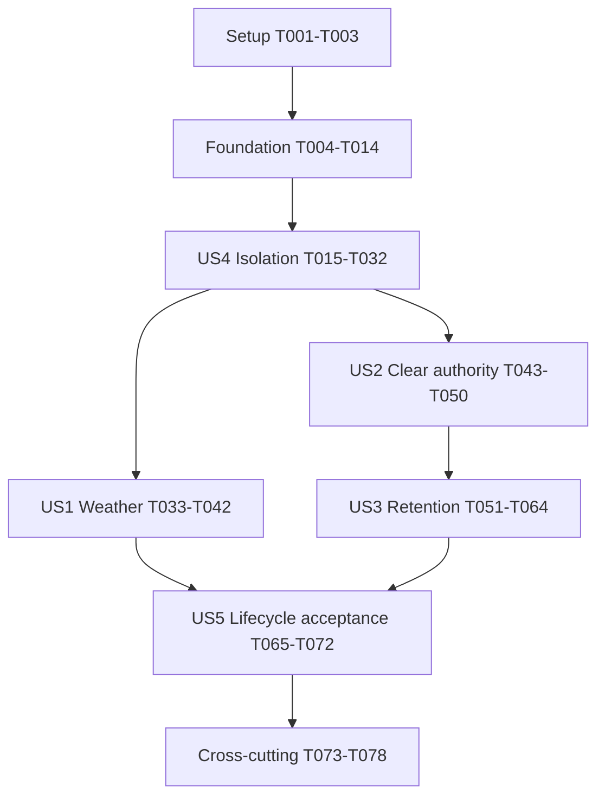

# Tasks: Safety Timing, Alarm Retention and Shared Backend Lifecycle

**Branch**: `codex/003-heating-monitoring`

**Input**: [spec.md](spec.md), [plan.md](plan.md), [research.md](research.md),
[data-model.md](data-model.md), [contracts](contracts/) and [quickstart.md](quickstart.md).

**Tests**: Required by the specification, safety contracts and constitution.
Write failing regressions before the corresponding behavior changes. Existing
passing tests alone do not prove these newly identified failure cases fixed.

**Organization**: Shared lifecycle is foundational because all P1 stories depend
on it. P1 tie order is US4 response isolation, US1 weather timing, US2 authoritative
clear, US3 retention. US5/P2 completes the six-family lifecycle acceptance after
foundation migration. This avoids implementing timing on a blocking response path.

**Notation**: `[P]` means distinct files and prerequisites satisfied at phase
entry; other tasks are sequential. New paths are explicit implementation targets,
not claims that those modules already exist. No task authorizes deployment, live
HA actions, household actuator tests or private configuration application.

## Phase 1: Setup

**Goal**: Establish the actual baseline and preserve the accepted safety scope.

- [ ] T001 Inspect `AGENTS.md`, `CONTRIBUTING.md`, `.specify/memory/constitution.md` and `docs/features/004-safety-timing-alarm-retention/plan.md`; verify branch/status, checklist and feature-003 coexistence, preserve unrelated changes, and record scope/evidence in `docs/features/004-safety-timing-alarm-retention/tasks.md`.
- [ ] T002 Reconcile `docs/sys/SafetyComponent - SSRD.md`, `docs/sys/SafetyConcept - SYS.md`, `docs/features/Mobile Notification Delivery - Architecture.md`, `docs/features/Runtime State Storage - Architecture.md` and the four feature contracts before implementation; retain HARA goals, stable IDs, notification acceptance meaning and existing recovery permissions.
- [ ] T003 Inspect `backend/config/system_config.yml`, `backend/config/user_config.example.yml`, relevant tests and applicable ignored installation configuration without publishing private values; identify weather overrides needing explicit future correction and record baseline validation and supported-runtime evidence boundaries in `docs/features/004-safety-timing-alarm-retention/quickstart.md`.

## Phase 2: Foundation — Shared Lifecycle and Deterministic Harness

**Goal**: Shared execution infrastructure is safe before any story integration.
Domain algorithms remain with their components. Complete this phase before US4.

- [ ] T004 [P] Create `backend/tests/safety_lifecycle_support.py` with fictional six-family bindings, fake monotonic clock, owned listener/timer accounting, failure injection and a callback service adapter; support immediate, delayed, duplicate and never-completing callbacks without contacting HA.
- [ ] T005 [P] Create `backend/tests/test_shared_safety_lifecycle.py` with self-contained core fakes (no dependency on the incomplete T004 helper), failing start/stop/generation, explicit-input and result-quality contract tests; include descriptive text resembling an entity and cancellation failure with effective generation fencing.
- [ ] T006 Create typed `backend/components/core/lifecycle.py` with owner/runtime/generation, phase "constructed, started, stopped", independent enabled eligibility, typed cancellation handles and parent/child scopes; make start/stop idempotent, invalidate before cancellation, and bound resources to declared registrations plus one current qualification timer per channel.
- [ ] T007 Refactor `backend/components/safetycomponents/core/safety_mechanism.py` to use the shared scope, inert construction and explicit `monitored_entities`; preserve stable names, constructor parameter keys and `isEnabled` access with writes delegated to lifecycle invalidation; never infer inputs from arbitrary strings and never clear retained danger on disable/stop.
- [ ] T008 Normalize shared execution in `backend/components/safetycomponents/core/safety_component.py` and `backend/components/core/types_common.py`; distinguish "eligible-positive/negative versus unevaluable/inhibited/disabled", report each real evaluation once, preserve domain debounce and prohibit missing/failed evidence from becoming negative recovery.
- [ ] T009 Add scope-owned unsubscribe tokens and registration identity to `backend/components/core/event_bus.py`, preserving existing priority/order and explicit prerequisite-error semantics; extend `backend/tests/test_event_bus.py` for subscription cancellation and no duplicate registration.
- [ ] T010 Migrate explicit temperature/derivative and door/condition subscriptions plus timer ownership in `backend/components/safetycomponents/temperature/temperature_component.py` and `backend/components/safetycomponents/safety_doors/safety_doors_component.py`; preserve existing parameter names, callbacks and assertion timing.
- [ ] T011 Migrate shared source listeners/samplers into parent lifecycle scopes in `backend/components/safetycomponents/entity_monitor/entity_monitor_component.py` and `backend/components/safetycomponents/heating/heating_system_monitor_component.py`; do not duplicate one physical listener per mechanism or implement feature-003 thermal functionality here.
- [ ] T012 Migrate event/source-session/contact ownership in `backend/components/safetycomponents/internal_environmental_hazard/internal_environmental_hazard_monitor_component.py` and `backend/components/safetycomponents/external_hazard/external_hazard_component.py`; preserve full indoor event payloads, existing source continuity, immediate alarm ingestion and independent domain qualification timers.
- [ ] T013 Integrate disabled-start, eligible-enable and quiescent stop ordering in `backend/SafetyFunctions.py`; stop ingress before owner write drain, preserve active assertions/output restrictions, retain process-owned external leases separately from scope handles and reject obsolete owner mutations/new dispatches.
- [ ] T014 Add new typed modules and converted shared mechanism boundaries to `mypy.ini`, with purpose-oriented docstrings and no weakening flags; run the new lifecycle/EventBus tests plus existing component suites, fixing scoped regressions before advancing and recording the precise remaining legacy typing boundary in `docs/features/004-safety-timing-alarm-retention/quickstart.md`.

## Phase 3: US4 — Independent Warning and Recovery Paths (P1)

**Goal**: MQTT, a throwing consumer or stalled target cannot block other eligible
response paths. **Independent test**: inject each failure during a new alarm and
measure root admission, healthy-target progress and recovery policy independently.

### Tests first

- [ ] T015 [P] [US4] Extend `backend/tests/test_fault_manager.py` with the failing MQTT-before-fault-event regression and immutable response ordering/deduplication cases; assert authoritative active state and independent response admission despite projection failure.
- [ ] T016 [P] [US4] Create `backend/tests/test_service_dispatcher.py` covering lease-before-immediate-callback, stalled target, finite process credits, rapid completion reuse, overload, repeated reload, late/duplicate callback and desired-versus-accepted projection boundaries.
- [ ] T017 [P] [US4] Extend `backend/tests/test_system_notification_recovery.py` with throwing first consumer, notification admission before recovery, slow/failing transport and persistence, latest-policy queued dispatch and no duplicated action/false acceptance.

### Implementation and integration

- [ ] T018 [US4] Create `backend/components/core/response_events.py` with immutable runtime/incident/event/revision, stable fault/symptom IDs, severity/state and allowlisted context: "Context is capped at 16 KiB; total event at 32 KiB"; omit excessive detail explicitly without dropping activation/admission and bound current consumer receipts by the configured catalog/current incidents.
- [ ] T019 [US4] Refactor `backend/components/faults_manager/fault_manager.py` and explicit isolated response routing in `backend/components/core/event_bus.py` to commit authoritative fault state before projection, preserve per-incident order, continue after an independent consumer throws and record nonrecursive local admission failure; never automatically replay a command or swallow prerequisite failures.
- [ ] T020 [US4] Create `backend/components/core/service_dispatcher.py` with immutable operation/runtime/generation/resource/tag revisions and absolute enqueue deadlines; enforce "1024 records / 4 MiB, payload <=64 KiB", allowlisted resources/services, per-target serialization, latest unsent intent coalescing and explicit overload without false delivery.
- [ ] T021 [US4] Implement process-lifetime lease registry and completion credits in `backend/components/core/service_dispatcher.py`: "at most 64 credits exist" across all generations, reserved capacity for one MQTT lane, two local resources and one recovery resource; hold credit until owner drain, retain unresolved retired resources and synchronize registry creation/access across reloads.
- [ ] T022 [US4] Implement AppDaemon `callback=` admission and completion mailbox in `backend/components/core/service_dispatcher.py`; register lease before call, normalize completion/error to 4 KiB, reserve one mailbox slot per lease and drain at most 64 records per owned tick at least once per second; callbacks enqueue only, never mutate domain state, and no unsupported `return_result`, `timeout` or `hass_timeout` arguments/fallback are permitted.
- [ ] T023 [US4] Implement deadline/quarantine and teardown in `backend/components/core/service_dispatcher.py`: timeout does not release unresolved work or create replacement threads/calls, old completion may release its lease but cannot update the new domain, and retired idle resources may be pruned without evicting unresolved leases; preserve absolute deadlines and historical deadline misses.
- [ ] T024 [US4] Adapt `backend/components/notification_manager/mobile_push_provider.py` and `backend/components/notification_manager/models.py` to independent per-target intents/completions; scheduling return is in-flight, reviewed completion None retains existing acceptance meaning, and stable-tag clear/SET/acknowledgement/urgency revisions cannot overtake newer content or downgrade an undelivered alert to quiet.
- [ ] T025 [US4] Refactor `backend/components/notification_manager/notification_manager.py` to fast lifecycle admission and root-owned completion, with one immutable in-flight/one coalesced pending persistence snapshot in its existing namespace; report durability/delivery failure without blocking fault/recovery, and own WAN/action/tick listener handles through lifecycle scopes.
- [ ] T026 [US4] Integrate `backend/components/notification_manager/local_annunciator.py` with independent bounded dispatch and current output eligibility; queued intent must recheck gas restrictions immediately before handoff, stop invalidates unsent work without an off/reset command, and already handed-off external effects remain explicitly unknown when unresolved.
- [ ] T027 [US4] Refactor `backend/components/core/mqtt_entity_manager.py` to desired/accepted revisions and coherent ordered projection groups, bounded to "4096 pending groups / 8 MiB / 256 KiB per group"; retain topics/discovery/heartbeat/retirement semantics, treat queue admission separately from actual completion and show mismatched multi-topic projection as uncertainty rather than clear.
- [ ] T028 [US4] Add startup/offline publication barriers to `backend/components/core/mqtt_entity_manager.py` and `backend/SafetyFunctions.py`; serialize the one MQTT lane across old/new generations, never bypass a quarantined call, and distinguish logical stop from the eventual ordered offline publication and configured expiry limit.
- [ ] T029 [US4] Adapt `backend/components/recovery_manager/recovery_manager.py` to nonblocking policy admission and scope-owned lifecycle; keep exact durable proposal/token acknowledgement and revalidate current incident, consent expiry, restrictions, resource and physical postcondition policy at actual queued command dispatch. Do not replay or automatically retry an execution-unknown handed-off command.
- [ ] T030 [US4] Extend `backend/tests/test_mqtt_entity_manager.py`, `backend/tests/test_notification_state_store.py` and `backend/tests/test_recovery_man.py` for desired/accepted cache, coherent discovery/attributes/state, failed snapshot acknowledgement, queued authorization races and old/new runtime publication barriers; assert local failure reporting cannot recurse into the failing publisher.
- [ ] T031 [US4] Create `backend/tests/test_appdaemon_service_contract.py` to exercise the actual supported packaged AppDaemon >=4.5,<5 HASS callback adapter in a non-household harness, including immediate/None/failure/never completion and callback forwarding. Record evidence in `docs/features/004-safety-timing-alarm-retention/quickstart.md`; an installed out-of-range library or stub-only result cannot satisfy this gate.
- [ ] T032 [US4] Integrate `backend/SafetyFunctions.py` with the process broker and isolated consumer admissions, then run T015..T017/T030/T031 acceptance including one permanently stalled target plus healthy targets, bounded queue saturation, reload with outstanding work and late acceptance. Record measured admission/independent deadline evidence in `docs/features/004-safety-timing-alarm-retention/tasks.md` without claiming phone receipt or physical cancellation.

**Checkpoint**: Independent paths proceed within allocations under a failed
adapter. Capacity/deadline failure is explicit, not successful delivery. This is
the first independently valuable runtime increment after foundation.

## Phase 4: US1 — Weather Warning Within 120 Seconds Total (P1)

**Goal**: All modeled and official weather warnings fit the total allocation.
**Independent test**: measure usable-input -> dispatch -> parallel qualification
-> decision -> HA acceptance/failure with fake clock and the real dispatcher.

- [ ] T033 [P] [US1] Extend `backend/tests/test_external_hazard_component.py` with weather 74.999/75 s and door 59.999/60 s boundaries, both onset orders, windows and both official urgency classes; test continuity reset, repeated qualifying observations and no sequential 75+60 delay.
- [ ] T034 [P] [US1] Extend `backend/tests/test_external_hazard_config.py` with NaN/infinity/negative/over-budget timing rejection and independent AQ policy; preserve positive-clear defaults and reject a 120 s weather-persistence override instead of silently clamping it.
- [ ] T035 [US1] Update `backend/config/system_config.yml`, `backend/config/user_config.example.yml` and `backend/components/safetycomponents/external_hazard/schema.py`: weather confirmation 75 s, independent `outdoor_air_quality.default_persistence_seconds: 300`/compiled `persistence_seconds`, positive-clear 120 s and concurrent door 60 s. Validate "dispatch + max(weather, opening) + decision + notify <= 120" with finite positive stage limits and 9 s reconciliation plus <=1 s decision.
- [ ] T036 [US1] Compile and validate matching weather/AQ defaults/overrides in `backend/configuration_model.py` and `backend/build_app_config.py`, extending `backend/tests/test_config_compiler.py`; explicit installed weather overrides above the budget must be corrected in a later authorized configuration workflow, never silently coerced here.
- [ ] T037 [US1] Update qualification selection/timers in `backend/components/safetycomponents/external_hazard/external_hazard_component.py` by HazardType; start receiver-monotonic qualification without cached-age credit, retain per-provider/hazard continuity, official validity and existing immediate-aperture exception, and do not wait for the next poll or stack generic SET debounce.
- [ ] T038 [US1] Add usable-input enqueue/dispatch timing evidence to `backend/components/external_apis/core/api_runtime.py` and its existing runtime tests; begin response accounting before internal dispatch with the relevant aperture available, preserve absolute onset through repeated observations and expose queue/load overruns instead of restarting the budget.
- [ ] T039 [US1] Align weather/AQ field limits/help in `frontend/src/components/configurationFieldSchemas.ts` and `frontend/src/content/configurationHelp.ts`; preserve installed drafts and field identities, show separate assertion/clear timing and reject unsupported weather combinations consistently with the backend.
- [ ] T040 [US1] Extend `frontend/tests/ui/provider-configuration.spec.ts` and configuration domain tests for weather/AQ save/import/validation and unchanged provider selection; use mock fixtures only and assert the 120 s total response meaning rather than a 120 s debounce label.
- [ ] T041 [US1] Extend `backend/tests/test_external_hazard_startup.py` and `backend/tests/test_system_notification_recovery.py` with the full "5 + max(75, 60) + 9 + 1 + 30 = 120" pipeline, exact 119/120/121 s endpoint outcomes, stalled/failed acceptance and unchanged AQ 299/300 s and positive-clear 120 s behavior; verify all weather hazards and selected live warning sources.
- [ ] T042 [US1] Reconcile measured timing/configuration evidence in `docs/features/External Hazard Monitoring - Architecture.md`, `docs/reference/System Configuration.md` and `docs/features/004-safety-timing-alarm-retention/quickstart.md`; preserve physical-onset/provider-poll assurance limits and do not claim successful warning on failed HA acceptance.

## Phase 5: US2 — New Authoritative Clear Evidence (P1)

**Goal**: Historical off cannot erase danger; default clear requires 30 newly
observed seconds. **Independent test**: fresh alarm, old off, then a reviewed live
clear transition with interruption and exact monotonic deadline cases.

- [ ] T043 [P] [US2] Extend `backend/tests/test_internal_environmental_hazard_component.py` with one-day-old off after fresh alarm, startup/readback/attribute-only off, 29.999/30 s boundary, unknown/test/hush/link loss, reordering and obsolete timer token cases across smoke/gas/CO/leak.
- [ ] T044 [P] [US2] Extend `backend/tests/test_internal_environmental_hazard_config.py` for reviewed source/profile authority, contradictory state sets, absent producer order and preserved default 30 s clear interval; receiver receipt/session must never become an invented producer epoch or timestamp.
- [ ] T045 [US2] Create typed `backend/components/safetycomponents/internal_environmental_hazard/observation.py` and integrate its schema: provenance "live_event", "startup_snapshot", "readback" or "restored_checkpoint", stable detector/entity/channel/profile version and binding fingerprint, normalized state, receiver session/monotonic receipt, optional reviewed producer order/time with absence explicit.
- [ ] T046 [US2] Refactor classification/event admission in `backend/components/safetycomponents/internal_environmental_hazard/internal_environmental_hazard_monitor_component.py` so default recovery starts only from an accepted current-session alarm-to-clear transition after the alarm watermark; cached or unknown-to-clear state cannot initiate qualification and source proof is never invented.
- [ ] T047 [US2] Implement clear candidate lifecycle in `backend/components/safetycomponents/internal_environmental_hazard/internal_environmental_hazard_monitor_component.py` with incident/binding/session/token, complete monotonic start/deadline and no historical-age subtraction; reset on alarm, unavailable/test/hush, reconnect, unconfirmed continuity or uncertain order, then recheck current identity and reviewed continuity before eligible recovery.
- [ ] T048 [US2] Bind reconnect/initial-sync callbacks and qualification cancellation into `backend/SafetyFunctions.py`, `backend/components/core/lifecycle.py` and the indoor observation adapter; extend `backend/tests/test_internal_environmental_hazard_startup.py` for restart/reconnect at second 29 and readback that may confirm but never create a clear candidate.
- [ ] T049 [US2] Capture sanitized event-contract fixtures in new `backend/tests/fixtures/indoor_event_contract.json` from a non-household supported-runtime harness for alarm, clear, same-state, initial sync, unknown-to-clear and reconnect; identify what the adapter truly receives and keep unproven source contracts active/unverified. Document reviewed provenance in `docs/features/004-safety-timing-alarm-retention/quickstart.md`, without requiring a real household detector test.
- [ ] T050 [US2] Run the indoor authority matrix in `backend/tests/test_internal_environmental_hazard_component.py` and `backend/tests/test_internal_environmental_hazard_startup.py`, including immediate new alarm during qualification and failed clear eligibility; preserve existing ten-second positive-alarm allocation and no new output/HEAL from stopped or ambiguous evidence. Durable CLEAR integration remains gated by US3.

## Phase 6: US3 — Retain Danger and Gas Inhibition Across Removal (P1)

**Goal**: Removed/rebound/disabled detectors cannot erase unresolved danger or
independent gas restrictions. **Independent test**: restart persisted gas danger
with detector absent/component disabled and inspect the first fault/global output.

- [ ] T051 [P] [US3] Extend `backend/tests/test_internal_environmental_hazard_startup.py` with removed detector/profile, changed binding, disabled/empty component and original incident preservation before first publication; include CLEARED alarm journal plus retained gas latch and corrupt/missing prior checkpoint.
- [ ] T052 [P] [US3] Create `backend/tests/test_indoor_retained_state.py` for legacy orphan conversion, strict field/byte/count validation, failed SET/CLEAR/dirty-marker writes, generation acknowledgements, overflow, proven cold start versus missing history and crash interleavings around CLEAR/new SET/clean drain.
- [ ] T053 [US3] Implement a strict version-2 envelope in `backend/components/safetycomponents/internal_environmental_hazard/state_store.py` with existing namespace `internal_environment_state`, owner generation/clean-dirty marker and current/retained-unverified/orphan records; preserve stable detector/symptom/fault/incident, trusted hazard, original binding/profile fingerprint, UTC activation, bounded cause, reviewed clear watermark and independent gas latch. Validate against the trusted catalog rather than arbitrary persisted fault names.
- [ ] T054 [US3] Enforce data-model limits in `backend/components/safetycomponents/internal_environmental_hazard/state_store.py`: "Maximum 4096 records and 1 MiB UTF-8 encoded envelope", "technical IDs to 128 characters, entity IDs to 255, display text to 256", "each cause/context to 4 KiB and depth 4"; require finite numbers, UTC-aware timestamps, unique well-formed identities and current admission "default 64 / maximum 256"; never silently truncate/evict active assertions.
- [ ] T055 [US3] Implement bounded atomic legacy upgrade and configuration-independent record retention in `backend/components/safetycomponents/internal_environmental_hazard/state_store.py`; preserve every legacy true alarm/gas latch including absent detectors, retain old clear timestamps only as history and never treat file absence or corrupt shared storage as proof of first installation.
- [ ] T056 [US3] Add one in-flight/one coalesced pending immutable writer and acknowledgement ordering in `backend/components/safetycomponents/internal_environmental_hazard/state_store.py`; failed SET preserves in-memory danger, failed CLEAR denies HEAL/release, and acknowledgement must match incident/generation/candidate with no newer positive evidence. Avoid synchronous retry on the immediate alarm path.
- [ ] T057 [US3] Bootstrap the indoor assertion owner in `backend/SafetyFunctions.py` before component enablement, inactive-fault filtering and first MQTT/fault/global registration; load its trusted retained catalog and reconcile current/journal evidence even when no indoor component is instantiated, independently of heating/external owners.
- [ ] T058 [US3] Extend owner-neutral retained assertion reconciliation in `backend/components/faults_manager/fault_manager.py` and rehydration in `backend/components/safetycomponents/internal_environmental_hazard/internal_environmental_hazard_monitor_component.py`; preserve original contributors/cause and UNEVALUABLE active state, never match replacement equipment only by friendly name and never delete orphan records on current-detector saves.
- [ ] T059 [US3] Install independent gas restrictions before response/output startup in `backend/SafetyFunctions.py` and `backend/components/notification_manager/local_annunciator.py`; preserve inhibition after alarm HEAL and absent bindings, expose unknown fail-closed restriction after prior checkpoint loss even with a CLEARED journal, and add no new gas reset or off command.
- [ ] T060 [US3] Implement dirty-session admission/clean shutdown in `backend/SafetyFunctions.py` and the indoor state owner: commit dirty marker before observations; marker failure denies recovery/unapproved output while positive alarms remain immediate. Clean shutdown stops ingress, cancels candidates, drains/acks writes and atomically marks clean; any incomplete step stays dirty. Unclean restore reconciles generations and never trusts an old CLEAR against a possibly lost newer SET.
- [ ] T061 [US3] Expose bounded current/retained/orphan, clear-wait, gas-inhibition and persistence uncertainty through the indoor monitor and `backend/components/core/self_diagnostics.py`; enforce "64 KiB and 64 detailed records", total/omitted counts and all-record danger aggregation, with no confirmed physical-gas claim from unknown recovery and no false healthy disabled projection.
- [ ] T062 [US3] Update `frontend/src/domain/internalHazards.ts`, `frontend/src/domain/internalHazards.test.ts` and `frontend/src/pages/InternalHazards.tsx` for retained danger independently of current monitoring, orphan identities, source/clear/persistence uncertainty and independently latched gas restriction; use bounded additive attributes and preserve routes, raw states and technical IDs.
- [ ] T063 [US3] Update EN/PL/DE indoor runtime labels in `backend/components/core/localization.py` and associated frontend presentation strings, then extend `backend/tests/test_internal_environmental_hazard_component.py` and indoor browser fixtures in `frontend/tests/ui/safety.spec.ts`; verify Polish UI, meaning parity, disabled-but-active presentation and HEAL wording that does not authorize safe re-entry.
- [ ] T064 [US3] Integrate US2 candidate proof with durable CLEAR in `backend/components/safetycomponents/internal_environmental_hazard/internal_environmental_hazard_monitor_component.py`, running T051/T052 plus simultaneous independent hazard contributors, old CLEAR acknowledgement after newer SET, crash before acknowledgement, failed clean drain and lost checkpoint after HEAL. Record retention/startup/output-policy evidence in `docs/features/004-safety-timing-alarm-retention/tasks.md`.

## Phase 7: US5 — Consistent Lifecycle Across All Six Families (P2)

**Goal**: Complete and verify the foundation's user-visible lifecycle behavior.
**Independent test**: one adapter matrix for all six real component families,
with metadata-only changes and injected late callbacks during stop/restart.

- [ ] T065 [P] [US5] Extend `backend/tests/test_shared_safety_lifecycle.py` with the six-family adapter matrix for double start/stop, same-instance restart, disable/re-enable, failed cancellation, active restrictions and exact subscription ownership; old-generation callback must produce no owner-state change or new service submission.
- [ ] T066 [P] [US5] Extend `backend/tests/test_safety_component_core.py` and `backend/tests/test_recovery_man.py` with typed valid-negative versus unevaluable/inhibited/disabled simulation, no event/timer/state side effects and once-only evaluation telemetry; preserve safe recovery policy without interpreting failed evaluation as a resolved hazard.
- [ ] T067 [US5] Complete explicit subscription/result adapters in `backend/components/safetycomponents/temperature/temperature_component.py` and `backend/components/safetycomponents/safety_doors/safety_doors_component.py`, correcting only failures exposed by T065/T066; keep forecast derivative listeners and optional door condition input exact, metadata-only edits inert and existing assertion/open-duration behavior unchanged.
- [ ] T068 [US5] Complete parent/child ownership adapters in `backend/components/safetycomponents/entity_monitor/entity_monitor_component.py` and `backend/components/safetycomponents/heating/heating_system_monitor_component.py`; one child's disable/stop must not cancel a still-required shared source, and the same diagnostic/thermal kernels must retain their prior behavior.
- [ ] T069 [US5] Complete source-session and EventBus lifecycle integration in `backend/components/safetycomponents/internal_environmental_hazard/internal_environmental_hazard_monitor_component.py` and `backend/components/safetycomponents/external_hazard/external_hazard_component.py` against T065; prevent replay of old clear/weather qualification and preserve latest active danger across disable/restart, with no extra generic debounce on the positive alarm path.
- [ ] T070 [US5] Integrate explicitly read-only typed simulation in `backend/components/recovery_manager/recovery_manager.py` with `backend/components/safetycomponents/core/safety_component.py`; resolve current component identity through its authoritative registry and reject obsolete/unevaluable simulated results as action-resolution proof.
- [ ] T071 [US5] Complete scope-owned start/stop cleanup in `backend/components/notification_manager/notification_manager.py`, `backend/components/recovery_manager/recovery_manager.py` and `backend/SafetyFunctions.py`; cancel owner listeners/timers/drains and invalidate unsent work while process-broker in-flight leases remain explicitly tracked/unknown.
- [ ] T072 [US5] Run all six real component adapter suites, comparing their domain timing and stable mechanism/fault/topic/entity identifiers before/after the migration; record SC-009/010 results, declared handle counts and the distinction between zero new obsolete dispatches and uncancellable already-handed-off effects in `docs/features/004-safety-timing-alarm-retention/quickstart.md`.

## Phase 8: Polish and Cross-Cutting Acceptance

- [ ] T073 Add combined retained heating/indoor-gas/external startup regressions to `backend/tests/test_internal_environmental_hazard_startup.py`, `backend/tests/test_heating_monitor.py` and `backend/tests/test_external_hazard_startup.py`; restore owners before initial publication without one owner filtering/overwriting another. Exercise whichever feature-003 modules are implemented, keeping absent thermal capabilities excluded rather than inventing coverage.
- [ ] T074 Verify supported-runtime source/service admission evidence and every FR-001..023 / SC-001..010 / story acceptance scenario against the coverage matrix in `docs/features/004-safety-timing-alarm-retention/tasks.md`; close scoped gaps without weakening HARA/SYS timing, source authority, durability or resource bounds.
- [ ] T075 Reconcile final implementation/configuration examples and local links in `docs/features/004-safety-timing-alarm-retention/quickstart.md`, affected architecture/reference documents and `README.md`; report actual implementation/installation limits separately from normative requirements and preserve English source documentation with Polish UI and EN/PL/DE runtime parity.
- [ ] T076 Run root backend checks from `AGENTS.md` (Ruff, mypy, pytest and coverage) and frontend test/typecheck/lint/format/build plus mock browser regressions from `frontend/package.json`; record exact commands, mypy scope and results in `docs/features/004-safety-timing-alarm-retention/tasks.md`, distinguishing unchanged baseline failures from new failures rather than suppressing them.
- [ ] T077 Execute all nine scenarios from `docs/features/004-safety-timing-alarm-retention/quickstart.md` under deterministic timing/load/overload, permanent hang, crash and cancellation failures; include dispatch/queue latency within the 120 s weather, ten-second binary and existing supervision allocations, with no real household actions and no false delivery/durability/physical-cancellation claim.
- [ ] T078 Review scoped Git diff and safety evidence, update completed checkboxes only after their acceptance passes, and prepare the implementation PR description using `CONTRIBUTING.md`; report remaining admission limits and preserve unrelated work/secrets. Commit/push/merge/deploy only within that later authorized delivery workflow.

## Dependencies and Execution Order

IDs provide the default serial execution order. US1 and US2 may be developed
after US4 independently, but avoid concurrent edits to shared bootstrap/config/
monitor files. US3 models/tests may be prepared after foundation; its final CLEAR
integration requires US2 and response infrastructure. US5 tests the lifecycle
foundation and integrated stories rather than postponing core lifecycle work.

Feature 003 already has its own [61 tasks](../003-heating-monitoring/tasks.md).
Neither task list depends on unbuilt thermal functionality in the other. Integrate
shared bootstrap/lifecycle changes once, then rebase the later implementation and
rerun both suites; do not implement duplicate retention or dispatch owners.

## Parallel Examples

| Stage/story | Safe independent tasks after prerequisites |
| --- | --- |
| Foundation | T004 fixture module and T005 self-contained core contract tests |
| US4 | T015 FaultManager tests, T016 dispatcher tests and T017 integration tests |
| US1 | T033 component-clock tests and T034 configuration tests |
| US2 | T043 event/recovery tests and T044 profile/configuration tests |
| US3 | T051 startup tests and T052 retained-store tests |
| US5 | T065 adapter lifecycle matrix and T066 core/recovery simulation tests |

Only `[P]` tasks within the same ready phase are parallel by default. Shared-file
implementation tasks remain sequential even when different stories are otherwise
independent. Parallelism is optional; these examples do not authorize live actions.

## Implementation Strategy

The first safe incremental outcome is foundation plus US4: available warning and
recovery paths continue despite one failed diagnostic/delivery adapter. It is not
completion of all 004 safety corrections and does not establish the new weather or
indoor recovery behavior. Add US1, then US2/US3, complete six-family acceptance and
all cross-cutting gates before claiming feature 004 ready for deployment. Each
story is independently testable with fakes; no incremental checkpoint grants
household actuator or deployment permission.

## Coverage Summary

| Requirement / acceptance | Task allocation |
| --- | --- |
| FR-001..003; SC-001; US1 AC1..3 | T033..T042, T074/T077 |
| FR-004..007; SC-002/003; US2 AC1..3 | T043..T050, T064, T074/T077 |
| FR-008..012; SC-004/005; US3 AC1..3 | T051..T061, T064, T073/T077 |
| FR-013; SC-004/005 | T061..T063, T075/T076 |
| FR-014/015; SC-006 | T013, T023/T028/T029, T048, T057..T060, T073..T078 |
| FR-016/017; SC-007; US4 AC1/3 | T015/T017..T019, T027/T028/T030/T032 |
| FR-018; SC-008; US4 AC2 | T016/T017, T020..T026, T029..T032, T077 |
| FR-019..022; SC-009/010; US5 AC1..3 | T004..T014, T065..T072, T077 |
| FR-023; SC-006/010 | T002/T008/T013, T026/T029, T050, T064, T070..T078 |
| Supported AppDaemon/source admission | T003/T031/T049/T074; stub-only success cannot satisfy runtime/source proof |
| Bounds, overflow and crash ordering | T016/T018/T020..T023/T027/T030, T052..T056/T060/T064/T077 |

78 tasks; 13 marked `[P]`; story counts: US4 18, US1 10, US2 8, US3 14,
US5 8; shared setup/foundation 14 and cross-cutting 6. All checkboxes start open.
This is implementation readiness documentation, not evidence of implemented or
deployed fixes.
